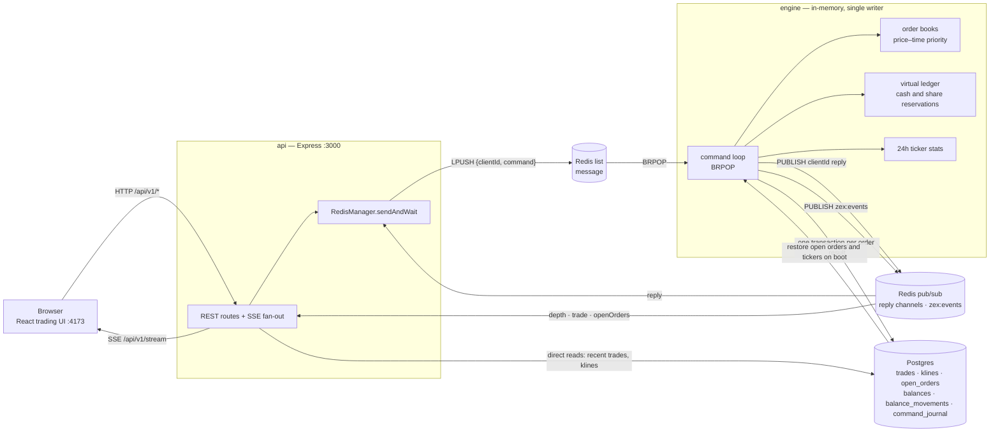

# Zex

A simulated stock-exchange backend: an Express API, a separate TypeScript price-time matching engine, Redis for command transport, and Postgres for virtual balances, trades, klines, open orders, and idempotency persistence.

- Architecture and design decisions: [docs/ARCHITECTURE.md](docs/ARCHITECTURE.md)
- Project status and next work: [docs/PROJECT.md](docs/PROJECT.md)

## Architecture



The engine is the only writer: orders, cancels, and reads all travel the Redis
queue, and every reply returns on a per-request pub/sub channel. A create or
cancel commits its trades, klines, open-order snapshot, balances, and
idempotency journal row in one Postgres transaction, then publishes depth,
trade, and openOrders events that the API forwards over SSE.
[docs/ARCHITECTURE.md](docs/ARCHITECTURE.md) covers the reasoning.

## Quick start

Everything, including the API and engine, with one command:

```bash
docker compose up -d
curl http://localhost:3000/api/v1/health
```

The trading UI is served at `http://localhost:4173`. It talks to the API
above, so keep port `3000` mapped for the browser. The frontend waits for the
API healthcheck before starting, so first boot lands on live data.

## Demo script (60 seconds)

```bash
# 1. Start everything and check health
docker compose up -d
curl http://localhost:3000/api/v1/health

# 2. See the seeded market: depth, a recent trade, a candle, ticker stats
curl "http://localhost:3000/api/v1/depth?symbol=ACME_USD"
curl "http://localhost:3000/api/v1/trades/recent?market=ACME_USD&limit=5"

# 3. Place a crossing order and watch it fill, then open the UI
curl -X POST http://localhost:3000/api/v1/order \
  -H "Content-Type: application/json" \
  -H "Idempotency-Key: demo-order-0001" \
  -d '{"market":"ACME_USD","price":"12","quantity":"1","side":"buy","userId":"user-1"}'
curl "http://localhost:3000/api/v1/trades/recent?market=ACME_USD&limit=5"
# open http://localhost:4173
```

The initial Postgres volume is seeded with virtual USD, ACME shares, and a
small ACME_USD order book. To replay the demo seed from scratch, run
`docker compose down -v` and start the stack again.

`/health` reports Redis and Postgres reachability. The engine restores open
orders and 24h ticker stats from Postgres before it starts consuming commands,
so it is safe to restart at any time.

To run the services outside Docker:

```bash
docker compose up -d redis postgres
npm --prefix engine install && npm --prefix engine run dev
npm --prefix api install && npm --prefix api run dev
npm --prefix frontend install && npm --prefix frontend run dev
```

The Vite dev server proxies `/api/v1` to the local API, so the UI works
without extra CORS setup. To point a built UI at another API host, build
with `VITE_API_BASE_URL` set.

The API listens on `http://localhost:3000`. Postgres is initialised from
`db/init` when the volume is first created; `docker compose down -v` resets it.

## Endpoints

| Method | Path | Purpose |
| --- | --- | --- |
| GET | `/api/v1/test` | Liveness probe |
| GET | `/api/v1/health` | Redis and Postgres connectivity |
| POST | `/api/v1/order` | Create a limit order |
| DELETE | `/api/v1/order/:orderId` | Cancel an open order |
| GET | `/api/v1/depth?symbol=ACME_USD` | Aggregated book depth |
| GET | `/api/v1/tickers` | 24h stats per market |
| GET | `/api/v1/klines?market=ACME_USD&interval=1m&startTime=0&endTime=9999999999` | OHLCV candles |
| GET | `/api/v1/orders/open?market=ACME_USD&userId=user-1` | A user's open orders |
| GET | `/api/v1/balances?userId=user-1` | Virtual cash and share balances |
| GET | `/api/v1/trades/recent?market=ACME_USD&limit=25` | Recent fills |
| GET | `/api/v1/stream` | Server-Sent Events: `depth`, `trade`, `openOrders` |

## Money handling

Price and quantity are decimal strings, never floats. The API validates them
against the engine's grammar and rejects anything the engine would truncate
past 8 decimal places; the engine scales them to `bigint` and compares
exactly. `api/src/validation/decimal.engine-parity.test.ts` holds both sides of
that contract in place.

## Idempotency

Send an `Idempotency-Key` header on order creation. Retrying with the same key
replays the original response; reusing it for a different request returns `409`.
The journal row commits in the same transaction as the book mutation, so a retry
after a crash cannot place a second order.

```bash
curl -X POST http://localhost:3000/api/v1/order \
  -H "Content-Type: application/json" \
  -H "Idempotency-Key: order-user-1-0001" \
  -d '{"market":"ACME_USD","price":"10","quantity":"1","side":"buy","userId":"user-1"}'
```

## Tests

```bash
npm --prefix engine test
npm --prefix api test
```

## Live end-to-end verification

`scripts/e2e-live.mjs` proves the whole order path against the running stack:
it resets and boots the demo stack, a crossing buy fills the seeded resting
sell, the trade and its 1m kline appear through the API, the buyer and seller
balances move by exactly the traded amounts, then a non-crossing buy is
cancelled and its reservation is released.

Docker (with the Compose plugin) and Node 18+ are the only requirements; the
script uses plain `fetch` and has no extra dependencies. The command is the
same in PowerShell, cmd, and Git Bash:

```bash
node scripts/e2e-live.mjs
```

The script runs `docker compose down -v` first - that wipes the demo volumes,
which is the documented reset. It exits non-zero with the first failed
assertion and prints a `PASS` summary with the observed values on success.
To check a stack that is already running (for example when the services are
started outside Docker), skip the compose steps:

```bash
node scripts/e2e-live.mjs --no-compose
```

`--no-compose` expects a freshly seeded stack; run `docker compose down -v`
after any earlier trading activity, otherwise the script's seed check fails
with that hint. `--base-url <url>` points the checks at a different API host.
